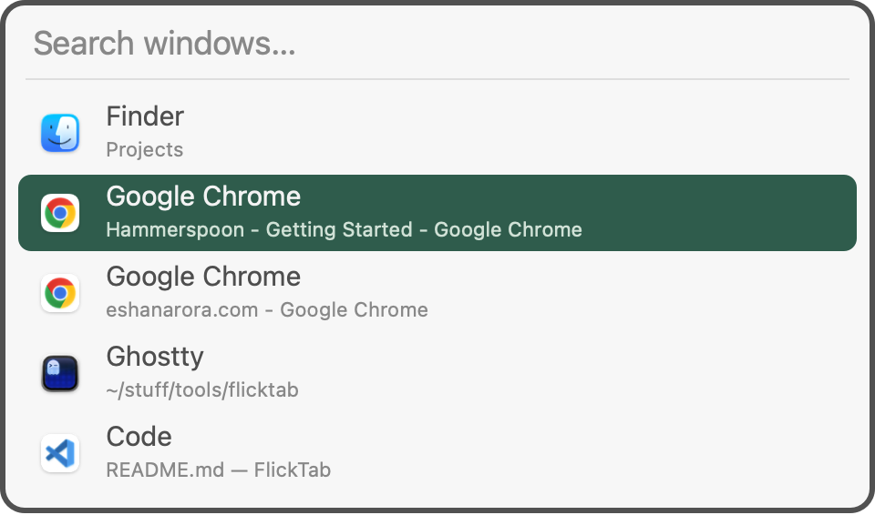

# Mac Alt-Tab Switcher

A searchable window switcher for macOS, built with [Hammerspoon](https://www.hammerspoon.org).

Hold **Command**, press **Tab**, and type to filter by app or window title. Release Command to switch. Windows appear in recent-use order; search handles abbreviations and typos.



## Install

Clone or download this repo, then run:

```sh
./setup
```

Setup works with new or existing Hammerspoon installations: it copies the Spoon and adds its startup line automatically, backing up and preserving your existing config. It installs Hammerspoon through Homebrew if needed. Without Homebrew, [install Hammerspoon](https://www.hammerspoon.org) first.

Allow Hammerspoon in **System Settings → Privacy & Security → Accessibility**, then choose **Reload Config** from its menu.

## Controls

| Key | Action |
| --- | --- |
| Command + Tab | Open / next window |
| Command + Shift + Tab | Previous window |
| Type while holding Command | Search |
| Release Command / Enter | Switch |
| Escape | Cancel |

Disable it from the **⌘⇥** menu to restore normal Command-Tab. To uninstall, remove its startup line and `MacAltTab.spoon`, then reload Hammerspoon.

The switcher runs locally: no network requests, saved searches, or saved window titles. It pauses while macOS Secure Input is active. Use one Command-Tab replacement at a time.
